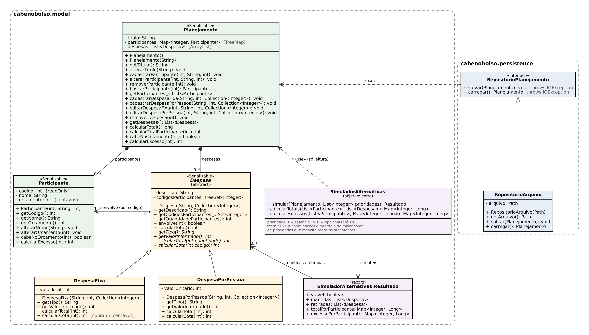

# Cabe no bolso — Planejador de despesas compartilhadas

Aplicação desktop em **Java Swing** para planejar as despesas de um passeio ou atividade em grupo. Ela calcula quanto cada participante vai gastar e indica se o valor cabe no orçamento de cada um.

Atividade final da disciplina **Programação Orientada a Objetos (N685)** — Universidade de Fortaleza (Unifor), 2026.2.

> **Relatório técnico:** enviado em PDF pelo AVA por todos os integrantes. <!-- TODO: opcional — colocar também o PDF em docs/relatorio.pdf -->

---

## Sumário

1. [Equipe](#equipe)
2. [Funcionalidades](#funcionalidades)
3. [Regras de cálculo e validação](#regras-de-cálculo-e-validação)
4. [Requisitos e instalação](#requisitos-e-instalação)
5. [Organização das pastas](#organização-das-pastas)
6. [Compilação e execução](#compilação-e-execução)
7. [Modelagem (UML)](#modelagem-uml)
8. [Caso de referência](#caso-de-referência)
9. [Como reproduzir os testes](#como-reproduzir-os-testes)
10. [Objetivo extra — simulador de alternativas](#objetivo-extra--simulador-de-alternativas)
11. [Uso de IA e referências](#uso-de-ia-e-referências)

---

## Equipe

<!-- TODO: preencher a coluna "Principais contribuições" de cada integrante -->

| Integrante | Matrícula | Principais contribuições |
|---|---|---|
| Luiz Monteiro Neto | 2642512 | |
| Samuel Diogenes Silva Holanda | 2641631 | |
| Letícia Gomes da Silva | 2630010 | |
| João Pedro Queiroz Ribeiro | 2641620 | |
| Vinícius Ferreira Cavalcante | 2642541 | |

---

## Funcionalidades

| Funcionalidade | O que a aplicação faz |
|---|---|
| **Participantes** | Cadastra código único, nome e orçamento disponível. Permite alterar nome e orçamento. |
| **Despesas** | Inclui, edita e exclui despesas com descrição, valor, tipo (fixa ou por pessoa) e participantes envolvidos. |
| **Rateio dos custos** | Despesa **fixa**: divide o valor entre os selecionados. Despesa **por pessoa**: cobra de cada selecionado o valor unitário. |
| **Resumo do planejamento** | Exibe as despesas, o custo total, o total individual e a situação de cada participante em relação ao orçamento. |
| **Persistência** | Salva e recupera o planejamento completo em arquivo local, incluindo os vínculos entre participantes e despesas. |

---

## Regras de cálculo e validação

- **Participação:** cada despesa tem pelo menos um participante cadastrado, sem repetições. Quem não participa de uma despesa contribui com zero nela.
- **Valores válidos:** orçamento **≥ 0** e despesa **> 0**. Campos vazios, códigos duplicados e entradas inválidas são recusados com mensagem, **sem alterar o estado anterior**.
- **Centavos:** todos os valores são guardados como `int` em **centavos** (`9000` = R$ 90,00), como na trilha de apoio; somas do planejamento usam `long`. No rateio fixo, os centavos que sobram da divisão são distribuídos, um a um, pela **ordem crescente dos códigos** dos participantes selecionados.
- **Orçamento:** total igual ao limite está **dentro do orçamento**. Acima dele, a aplicação mostra o valor excedido e permite salvar o planejamento para revisão.
- **Alterações:** os totais são recalculados após editar ou excluir despesas ou alterar orçamentos. Um participante só pode ser excluído se não houver despesas vinculadas a ele.

---

## Requisitos e instalação

| Item | Versão / observação |
|---|---|
| **JDK** | 25 (LTS) <!-- TODO: confirmar a versão usada pela equipe --> |
| **Interface gráfica** | Java Swing (já incluído no JDK) |
| **Dependências externas** | Nenhuma <!-- TODO: se usarem JUnit para testes automatizados, informar aqui --> |
| **IDE (opcional)** | IntelliJ IDEA, Eclipse ou NetBeans |
| **Sistema** | Windows, macOS ou Linux com ambiente gráfico |

Confira a instalação do JDK no terminal:

```bash
java -version
javac -version
```

Os dois comandos devem mostrar a versão 25.

Clone o repositório:

```bash
git clone https://github.com/luizmneto-ai/cabeNoBolso_prj.git
cd cabeNoBolso_prj
```

---

## Organização das pastas


```text
.
├── README.md
├── src/
│   └── cabenobolso/
│       ├── Main.java                  # cria modelo, visão e controlador e inicia a aplicação
│       ├── model/                     # MODELO: dados, cálculos e validações
│       │   ├── Planejamento.java
│       │   ├── Participante.java
│       │   ├── Despesa.java           # classe abstrata
│       │   ├── DespesaFixa.java
│       │   └── DespesaPorPessoa.java
│       ├── view/                      # VISÃO: telas Swing
│       │   └── TelaPrincipal.java
│       ├── controller/                # CONTROLADOR: liga eventos da tela ao modelo
│       │   └── ControlePlanejamento.java
│       ├── persistence/               # PERSISTÊNCIA: contrato e implementação em arquivo
│       │   ├── RepositorioPlanejamento.java   # interface salvar/carregar
│       │   └── RepositorioArquivo.java        # serialização de objetos
│       └── teste/
│           └── VerificacaoModelo.java  # caso de referência + testes 2 a 7 pelo terminal
├── docs/
│   ├── uml/diagrama-classes.png       # diagrama de classes atualizado
│   └── evidencias/                    # capturas de tela dos testes
└── dados/
    └── caso-referencia.dat            # arquivo de exemplo com o caso da seção 4
```

| Pacote | Responsabilidade (MVC) |
|---|---|
| `model` | Calcula e valida. Guarda participantes e despesas em coleções genéricas. |
| `view` | Recebe as entradas do usuário e mostra resultados e mensagens. |
| `controller` | Encaminha as ações da tela ao modelo e devolve o resultado à visão. |
| `persistence` | Define o contrato `salvar`/`carregar` e o implementa com serialização em arquivo. |

---

## Compilação e execução

### Pela IDE

1. Abra a pasta do projeto (no IntelliJ: **File → Open**).
2. Marque `src` como pasta de código-fonte, se a IDE não fizer isso sozinha.
3. Execute a classe `cabenobolso.Main`. A janela abre com um planejamento vazio e três abas: **Participantes**, **Despesas** e **Resumo**.

### Pelo terminal

Na raiz do repositório:

```bash
# Compilar (gera os .class na pasta out/)
javac -d out $(find src -name "*.java")

# Executar
java -cp out cabenobolso.Main
```

No Windows (PowerShell):

```powershell
javac -d out (Get-ChildItem -Recurse -Filter *.java src).FullName
java -cp out cabenobolso.Main
```

### Arquivo de dados

- O planejamento é salvo por **serialização de objetos** em um arquivo `.dat`.
- O arquivo de exemplo `dados/caso-referencia.dat` já contém o caso da seção 4. Para usá-lo, clique em **Abrir...** e selecione o arquivo.
- Os valores são digitados em **centavos inteiros** (ex.: `9000` para R$ 90,00), como na trilha de apoio. As tabelas mostram os valores formatados em reais.
- O arquivo é compatível com a versão final do código. Se as classes mudarem, gere o arquivo de novo pelo roteiro abaixo.

---

## Modelagem (UML)



<!-- TODO: inserir a imagem do diagrama atualizado em docs/uml/ -->

Principais decisões de modelagem:

- **Herança e polimorfismo:** `Despesa` é abstrata e declara `calcularTotal(int quantidadeParticipantes)` (como nas revisões 08 e 09) e `calcularCota(int codigoParticipante)`, que devolve quanto um participante paga. `DespesaFixa` e `DespesaPorPessoa` sobrescrevem os dois métodos. O planejamento guarda as despesas como `List<Despesa>` e chama os métodos pela referência do tipo abstrato.
- **Encapsulamento:** os atributos são `private`. Alterações passam por métodos que validam antes de mudar o estado (`alterarNome`, `alterarOrcamento`) e lançam `IllegalArgumentException` com a mensagem do erro, como na revisão 12.
- **Associações:** o `Planejamento` reúne participantes e despesas. Cada despesa guarda os **códigos** dos participantes selecionados, consultados no mapa do planejamento. Um participante só pode ser excluído quando nenhuma despesa usa o seu código.
- **Interface de persistência:** `RepositorioPlanejamento` define `salvar(Planejamento)` e `carregar()`, ambos com `throws IOException` (revisão 15). O controlador usa o contrato, e `RepositorioArquivo(Path)` o implementa: grava primeiro em um arquivo temporário e depois troca pelo definitivo, sem estragar a versão anterior se algo falhar.
- **Coleções:** `Map<Integer, Participante>` (`TreeMap`) para buscar pelo código, impedir código repetido e listar em ordem; `List<Despesa>` (`ArrayList`) para manter a ordem de cadastro e editar ou excluir pela posição; `TreeSet<Integer>` com os códigos de cada despesa, sem repetição e em ordem crescente, como exige a distribuição dos centavos. A trilha (revisão 11) usa `LinkedHashSet` e `LinkedHashMap`; trocamos pelas versões `Tree` justamente por causa dessa ordem.

---

## Caso de referência

Dados obrigatórios da seção 4 do enunciado.

**Participantes**

| Código | Nome | Orçamento |
|---:|---|---:|
| 1 | Ana | R$ 70,00 |
| 2 | Bruno | R$ 60,00 |
| 3 | Carla | R$ 70,00 |

**Despesas**

| Despesa | Tipo | Valor informado | Participantes |
|---|---|---:|---|
| Transporte | Fixa | R$ 90,00 | Ana, Bruno e Carla |
| Almoço | Por pessoa | R$ 20,00 | Ana, Bruno e Carla |
| Atividade recreativa | Fixa | R$ 30,00 | Ana e Carla |
| Sobremesa | Por pessoa | R$ 10,00 | Ana, Bruno e Carla |

**Resultado esperado**

| Pessoa | Transporte | Almoço | Atividade | Sobremesa | **Total** | Situação |
|---|---:|---:|---:|---:|---:|---|
| Ana | 30,00 | 20,00 | 15,00 | 10,00 | **75,00** | Excede em R$ 5,00 |
| Bruno | 30,00 | 20,00 | 0,00 | 10,00 | **60,00** | Dentro (igual ao limite) |
| Carla | 30,00 | 20,00 | 15,00 | 10,00 | **75,00** | Excede em R$ 5,00 |

**Custo total: R$ 210,00.**

### Roteiro para cadastrar o caso manualmente

1. Execute a aplicação. Ela abre com um planejamento vazio.
2. Na aba **Participantes**, cadastre os códigos 1, 2 e 3 com os orçamentos em centavos (`7000`, `6000`, `7000`).
3. Na aba **Despesas**, cadastre as quatro despesas: descrição, valor em centavos (`9000`, `2000`, `3000`, `1000`), tipo e participantes (Ctrl+clique para selecionar vários).
4. Confira o resumo com a tabela de resultado esperado.
5. Clique em **Salvar** (ou **Salvar como...**) para gerar o arquivo `.dat`.

---

## Como reproduzir os testes

<!-- TODO: preencher a coluna "Obtido" e o link da evidência após executar cada teste -->

| # | Cenário | Como executar | Resultado esperado | Obtido | Evidência |
|---|---|---|---|---|---|
| 1 | **Caso de referência** | Roteiro acima | Ana e Carla R$ 75,00 (excedem R$ 5,00), Bruno R$ 60,00 (dentro); total R$ 210,00 | | `docs/evidencias/01.png` |
| 2 | **Centavos no rateio** | Despesa fixa de R$ 100,00 para os códigos 1, 2 e 3 | R$ 33,34 / R$ 33,33 / R$ 33,33; soma R$ 100,00 | | `docs/evidencias/02.png` |
| 3 | **Entrada ou vínculo inválido** | Tentar salvar despesa sem participantes, com valor negativo ou com campo vazio | Mensagem de erro; dados anteriores inalterados | | `docs/evidencias/03.png` |
| 4 | **Alteração de orçamento** | No caso de referência, alterar o orçamento de Ana para R$ 80,00 | Ana continua com R$ 75,00, agora dentro do limite | | `docs/evidencias/04.png` |
| 5 | **Exclusão de despesa** | No caso original, excluir "Atividade recreativa" | R$ 60,00 por pessoa; total R$ 180,00 | | `docs/evidencias/05.png` |
| 6 | **Salvar e reiniciar** | Salvar o caso, fechar e abrir a aplicação, carregar | Todos os dados, vínculos e resultados recuperados, sem duplicar registros | | `docs/evidencias/06.png` |
| 7 | **Problema no arquivo** | Carregar arquivo inexistente ou inválido (ex.: um `.txt` renomeado para `.dat`) | Mensagem clara; o planejamento em uso é preservado; é possível iniciar um planejamento vazio | | `docs/evidencias/07.png` |

### Verificação automática do modelo (terminal)

A classe `cabenobolso.teste.VerificacaoModelo` executa o caso de referência e os testes 2 a 7 sem a interface gráfica e imprime `[OK]` ou `[FALHOU]` em cada verificação:

```bash
javac -d out $(find src -name "*.java")
java -cp out cabenobolso.teste.VerificacaoModelo
```

Para gerar de novo o arquivo de exemplo `dados/caso-referencia.dat` (necessário se as classes do modelo mudarem):

```bash
java -cp out cabenobolso.teste.VerificacaoModelo --gerar-dados
```

---

## Objetivo extra — simulador de alternativas

<!-- TODO: manter esta seção só se a equipe implementar o bônus; caso contrário, remover -->

Classifica as despesas em **essenciais** e **opcionais**. Cada opcional recebe uma prioridade inteira positiva. Para até dez opcionais, o simulador mantém todas as essenciais e busca a combinação de opcionais com **maior soma de prioridades** que respeite o orçamento de cada participante, sem alterar o planejamento original.

| Cenário | Resultado esperado |
|---|---|
| Caso de referência: transporte e almoço essenciais; atividade (prioridade 3) e sobremesa (prioridade 1) opcionais | Retirar a sobremesa e manter a atividade: Ana e Carla R$ 65,00, Bruno R$ 50,00, total R$ 180,00 |
| Mesmo caso com orçamento de Ana em R$ 40,00 | Sem solução: as essenciais de Ana custam R$ 50,00 (excesso de R$ 10,00) |
| Caso extra da equipe <!-- TODO --> | Comparação antes/depois: despesas mantidas, retiradas e novos totais |

Requisitos do simulador (seção 7 do enunciado):

- Exibir as despesas **mantidas** e **retiradas** e os **novos totais**, sem alterar o planejamento original. <!-- TODO: confirmar na tela -->
- Quando as essenciais não couberem, indicar o **excesso** e a **ausência de solução**. <!-- TODO -->
- Qualquer **empate ótimo** (mesma soma de prioridades) é aceito como solução. <!-- TODO: dizer qual critério de desempate a equipe usou -->
- Incluir um **caso extra** com comparação antes/depois e os testes no relatório e no repositório. <!-- TODO -->

**Algoritmo:** <!-- TODO: descrever, ex.: busca exaustiva das 2^n combinações de opcionais (n ≤ 10 → no máximo 1.024), descartando as que estouram algum orçamento e guardando a de maior prioridade -->

---

## Uso de IA e referências

- Ferramentas de IA foram usadas como apoio. Todo o código foi revisado e compreendido pela equipe, que conduziu a modelagem, as decisões e a análise dos resultados. <!-- TODO: descrever de forma honesta onde e como a IA foi usada -->
- Material da disciplina: trilha de apoio de POO (revisões 01 a 15), Prof. Tulio Rodrigues Ribeiro.
- Oracle. *The Java Tutorials* e documentação da API Java SE 25: Swing, Collections, Exceptions, Serialization.
- <!-- TODO: outras fontes usadas, no padrão ABNT no relatório -->
